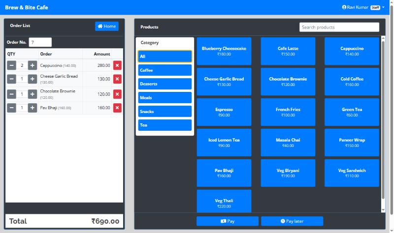
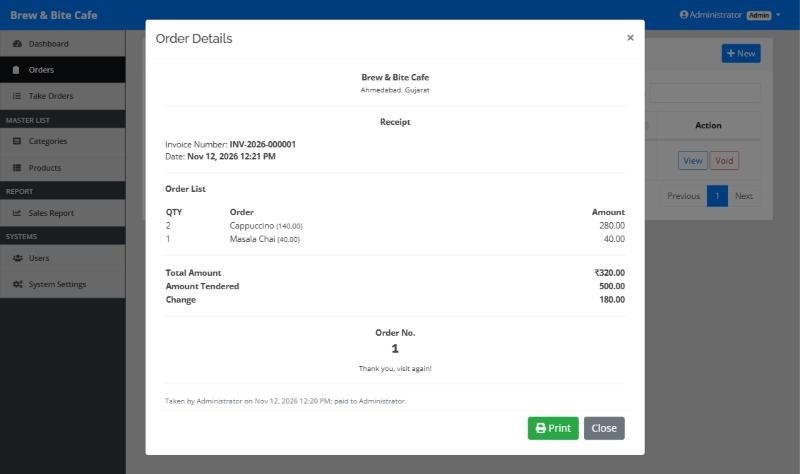
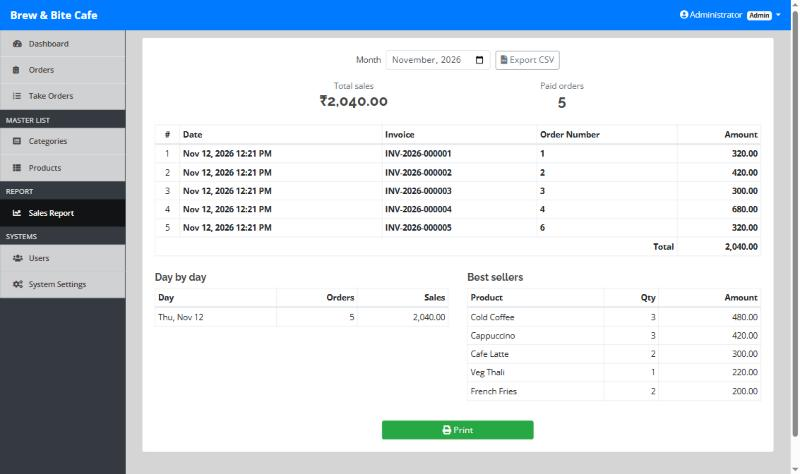

# Cafe Billing System

A point-of-sale and billing app for a cafe or small restaurant, built with **Django 5.2** and **PostgreSQL**.
Cashiers take orders on a touch-friendly till screen, bill them straight away or save them to pay later,
print receipts, and see a monthly sales report. Admins manage the menu, users and cafe details.



This is a rewrite of a PHP/MySQLi cafe billing project. The workflow and screens stay the same
(categories, products, take orders, pay or pay later, orders list, receipt, monthly sales report, users),
but the backend has been rebuilt from scratch, and the database and frontend have been improved where it mattered.

## Features

- **Take Orders (till screen):** products grouped by category, search, tap to add, quantity buttons, live total.
  **Pay** opens a calculator (amount tendered, change, quick cash buttons) and prints the receipt; **Pay later**
  saves the order as unpaid so it can be billed out from the Orders page.
- **Order numbers:** the queue number called out to the customer is suggested automatically (restarts each day) and
  can be changed.
- **Invoices:** every paid order gets a gap-free invoice number for the year (`INV-2026-000042`).
- **Orders:** list with search and sorting, view and print receipts, edit or delete unpaid orders, **void** paid
  orders (admin only, with a reason).
- **Sales report:** paid orders for any month with the total, a day-by-day summary, best sellers, print and CSV export.
- **Dashboard:** today's sales, paid and unpaid orders, this month's sales, best sellers and recent orders.
- **Menu:** categories and products with price and an available/unavailable switch.
- **Users:** admin and staff roles; staff only see Dashboard, Orders, Take Orders and Sales Report.
- **System settings:** cafe name, address, contact, currency symbol and receipt footer, printed on receipts.
- Works on phones and tablets (the sidebar collapses and the till screen stacks).

| Receipt | Sales report |
|---|---|
|  |  |

## What changed from the PHP version

| Area | PHP original | This version |
|---|---|---|
| SQL | Strings built from `$_POST` (SQL injection on every form) | Django ORM, parameterised queries only |
| Passwords | Unsalted MD5 | PBKDF2 (Django default), strength rules, current password needed to change it |
| Access control | AJAX endpoints open to anyone; admin pages only hidden in the menu | Every view requires login; admin views return 403 for staff |
| CSRF | None | Django CSRF protection on every form and JSON request |
| Money | `FLOAT` columns, totals sent by the browser | `NUMERIC(10,2)`; the server recalculates every price and total from the database |
| Paid orders | Could be edited or deleted, changing past sales | Locked once paid; an admin can only void them, and voids are left out of the report |
| Invoice number | Random 12 digits, uniqueness checked in a loop | Sequential per year, assigned inside a locked transaction, safe with several tills |
| Price history | Receipts read the current product name and price | Each line stores the name and price at the time of the order |
| Data integrity | No foreign keys or constraints | Foreign keys (`PROTECT` on menu items in use), unique names ignoring case, check constraints (e.g. a paid order must have an invoice and enough money tendered) |
| Deleting | Category or product delete left orphaned rows | Blocked with a clear message; products can be marked unavailable instead |
| Users | Hard delete | Deactivated, so past orders still show who took them; the last admin cannot be removed |
| XSS | Product data echoed into HTML attributes and JSON unescaped | Auto-escaped templates; menu data passed to JavaScript with `json_script` |
| Reports | Rows summed in PHP | Aggregated in PostgreSQL (`SUM`, `COUNT`, `TruncDate`) |
| Tests | None | 44 automated tests, run on PostgreSQL in GitHub Actions |

## Tech stack

| Area | Technology |
|---|---|
| Backend | Python 3.12+, Django 5.2 |
| Database | PostgreSQL (psycopg 3) |
| Frontend | Django templates, Bootstrap 4, jQuery, DataTables, Font Awesome |
| Static files | WhiteNoise |
| Tests and CI | Django test runner, GitHub Actions with a PostgreSQL service |

## Project structure

```
cafe-billing-system/
├── config/        settings (all from environment variables), URLs, WSGI
├── accounts/      custom user with admin/staff roles, user management, own account
├── menu/          categories and products
├── orders/        orders, order items, invoice numbering
│   └── services.py    all order rules: pricing, payment, invoice numbers, void, delete
├── core/          dashboard, sales report, CSV export, site settings
├── templates/     pages and modal partials
├── static/        style.css, app.js (shared helpers), pos.js (till screen)
└── .github/workflows/ci.yml
```

## Getting started

You need Python 3.12 or newer and PostgreSQL.

```bash
# 1. Create a database
createdb cafe_billing

# 2. Install
python -m venv .venv
source .venv/bin/activate          # Windows: .venv\Scripts\activate
pip install -r requirements.txt

# 3. Configure
cp .env.example .env               # then set DATABASE_URL and SECRET_KEY

# 4. Create the tables, a sample menu and the first admin
python manage.py migrate
python manage.py seed_demo --admin admin

# 5. Run
python manage.py runserver
```

Open http://127.0.0.1:8000 and log in with the admin you created. Leave out `seed_demo` and use
`python manage.py createsuperuser` if you want an empty menu.

### Tests

```bash
python manage.py test
```

The tests need a PostgreSQL user that can create databases (Django creates and drops a test database).

### Deploying

Set `DEBUG=False`, a long random `SECRET_KEY`, `ALLOWED_HOSTS`, `CSRF_TRUSTED_ORIGINS` (e.g. `https://cafe.example.com`)
and `DATABASE_URL`, then run `python manage.py migrate` and `python manage.py collectstatic`, and serve
`config.wsgi:application` with a WSGI server such as Gunicorn behind HTTPS.

## Design notes

- **One place for the rules.** `orders/services.py` holds the order logic and is used by the views and the tests, so
  pricing and payment rules are not spread across templates and JavaScript.
- **The browser is not trusted.** The till sends only product IDs and quantities; prices and totals come from the database.
- **Concurrency.** Invoice numbers come from a per-year counter row locked with `SELECT ... FOR UPDATE`; a test pays
  eight orders in parallel threads and checks the numbers are 1 to 8 with no duplicates or gaps.
- **Timezone aware.** Times are stored in UTC and reports group by the cafe's local day (`TIME_ZONE`, default Asia/Kolkata).

## Credits

The original PHP/MySQLi Cafe Billing System is a free sample project published on SourceCodester. This repository
reimplements its workflow in Django and PostgreSQL; the code here is new.

**Developer:** Akshat Shah
